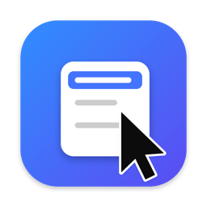

# 轻右键 QingRight

给 macOS 小白用的访达右键增强工具。极致轻量：安装包约 300 KB（Intel + Apple 芯片双架构），零第三方依赖。

## 功能（v0.3.0）
- 新建文件：txt / md / docx / xlsx（docx、xlsx 为合法空白文档）
- 复制路径（多选时一行一个）
- 在终端中打开
- 常用目录：一键打开，菜单栏图标里增删
- 复制到 / 移动到 常用目录（重名自动编号，不覆盖）
- 检查更新：菜单栏图标 →「检查更新…」，有新版一键更新（不会自动联网）

## 安装

**方式一：一行命令（推荐，零弹窗）**

打开「终端」，粘贴回车：
```sh
curl -fsSL https://raw.githubusercontent.com/ReRuol/QingRight/master/scripts/install.sh | bash
```
自动下载最新版、装进「应用程序」、启用访达扩展。

**方式二：DMG 拖拽安装**

1. 下载 [QingRight-0.3.0.dmg](https://github.com/ReRuol/QingRight/releases/download/v0.3.0/QingRight-0.3.0.dmg)（约 140 KB），双击打开，把「轻右键」拖到「应用程序」
2. 首次打开会提示「无法验证开发者」（开源软件没有付费签名）：打开「系统设置 → 隐私与安全性」，拉到底点「仍要打开」。只需一次
3. 打开后会自动登记并启用右键扩展；若仍未出现，点菜单栏图标 →「修复右键菜单…」

**右键里没有轻右键？** 终端执行：
```sh
xattr -dr com.apple.quarantine /Applications/QingRight.app && open /Applications/QingRight.app
```

所有版本：<https://github.com/ReRuol/QingRight/releases>

## 架构
```
访达 ──menu(for:)──▶ 扩展（沙盒，只拼菜单，常用目录只存内存）
                        │ 复制路径：扩展内直接完成
                        │ 其他：打开 qingright://run?d=<base64 JSON>
                        ▼
                   主 App（不沙盒，菜单栏常驻）执行文件操作
                   未运行时由 LaunchServices 拉起后执行
主 App ──分布式通知（常用目录）──▶ 扩展
```
不用 App Group，所以不需要 Apple 开发者 Team ID，ad-hoc 签名即可运行。

## 加一个新功能
1. `Shared/Shared.swift`：`Action` 里加一个 case
2. `Extension/FinderSync.swift`：`menu(for:)` 里加菜单项，动作函数里 `send(Request(...))`
3. `App/main.swift`：`Handler.perform` 里加对应分支

新建文件类型：往 `Templates/` 放 `blank.<扩展名>`，再在 `NewFileKind` 加一项。

## 构建
需要 Xcode 16+、[XcodeGen](https://github.com/yonaskolb/XcodeGen)。
```sh
scripts/release.sh   # 产出 zip + dmg，版本号取自 project.yml 的 MARKETING_VERSION
```

## 发版
1. 改 `project.yml` 的 `MARKETING_VERSION` / `CURRENT_PROJECT_VERSION`
2. `scripts/release.sh`（会用钥匙串里的私钥给 zip 签名，生成 `.zip.sig`）
3. `git tag vX.Y.Z && git push --tags && gh release create vX.Y.Z <dmg> <zip> <zip.sig>`

### 更新签名
App 内置 Ed25519 公钥（`App/Updater.swift`），只安装签名校验通过的更新包。
私钥只在发布者钥匙串里（条目名 `QingRight Update Signing Key`），由 `swift scripts/sign_update.swift keygen` 生成。
**私钥丢失 = 老版本无法自动更新**，请备份：`security find-generic-password -s "QingRight Update Signing Key" -w`，存进密码管理器。
Fork 发布请生成自己的密钥并替换 `Updater.publicKey`。

## License
MIT
